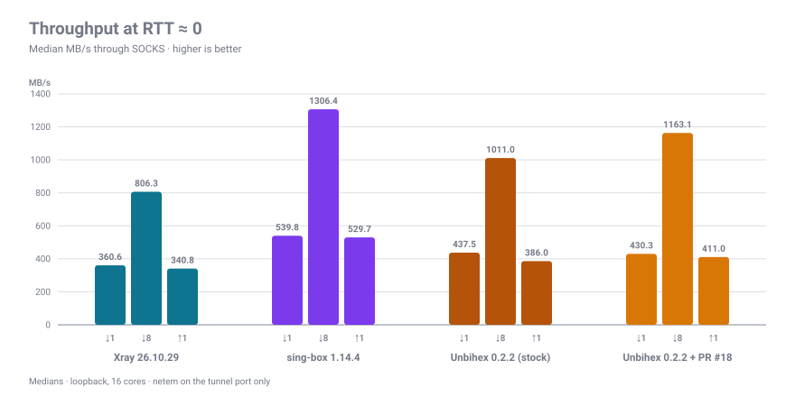
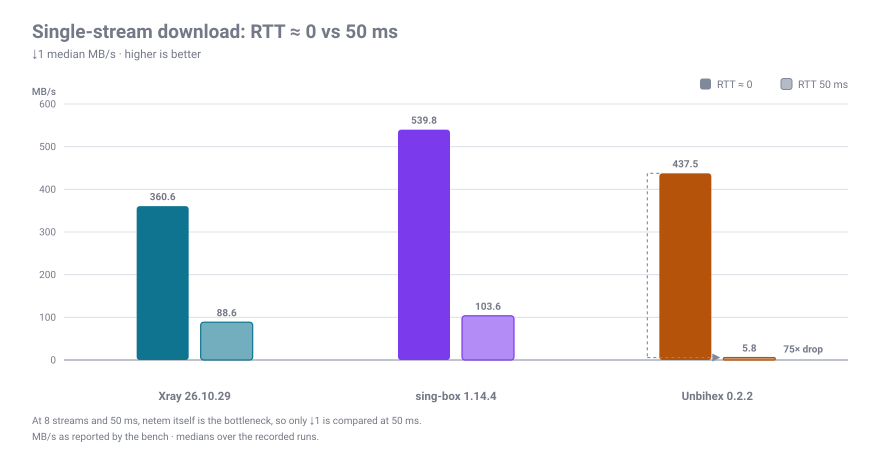
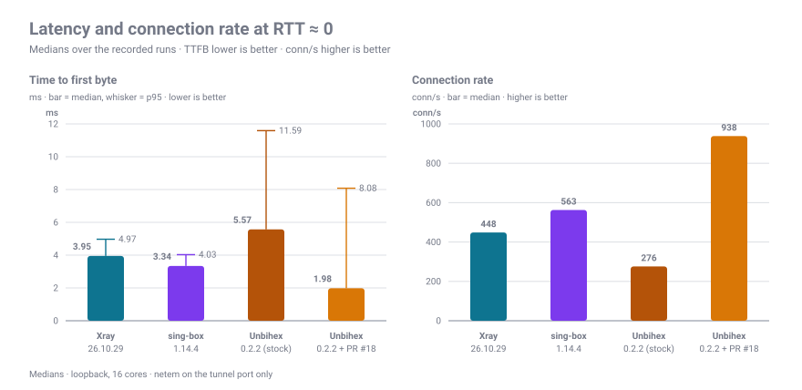
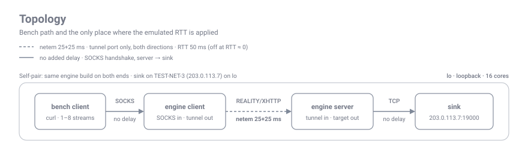

# xray-bench

**Русский** · [English](README.en.md)

[](https://github.com/pshakhmin/xray-bench/actions/workflows/bench.yml)

Воспроизводимый стенд для сравнения трёх прокси-движков — **Xray-core**, **sing-box** и
**Unbihex** — по схеме «SOCKS-инбаунд → REALITY/XHTTP → сервер → приёмник»: эмуляция RTT,
замеры throughput, TTFB, темпа соединений и CPU, провенанс в каждом результате.

Стенд отвечает на вопрос «какой движок быстрее в одинаковых условиях», а не «сколько даст
реальный канал». Ограничения перечислены ниже — прочитайте их до того, как цитировать цифры.

## Результаты

Бенчмарк — раннер GitHub Actions (`ubuntu-latest`, 4 vCPU) с профилем `wan`: MTU 1500,
GSO/TSO/GRO off, потери 0,1%, задержка `netem` только на порту туннеля. Ниже — последний прогон;
свежие цифры, графики и провенанс — на **<https://pshakhmin.github.io/xray-bench/>**.

| Движок (релизы) | ↓1 MB/s | ↓8 MB/s | ↑1 MB/s | TTFB | conn/s | ↓1, RTT 50 мс | TTFB, RTT 50 |
|---|---|---|---|---|---|---|---|
| Xray 26.10.29 | 152 [140–164] | 191 | 162 | 2.5 мс | 559 | 40.6 | 154 мс |
| sing-box 1.14.4 | 188 [181–194] | 207 | 188 | 2.4 мс | 395 | 44.3 | 153 мс |
| Unbihex 0.2.3 (`test_server` 0.0.1) | 108 [108–108] | 133 | 119 | 1.6 мс | 150 | 19.3 | 153 мс |

Прогон 2026-10-30, коммит `8dc2f29`; сырые JSON — в [`ci-results/`](ci-results), страница
пересобирается командой `python3 site/build.py`. Медианы из трёх прогонов, в скобках min–max.
Раннер — 4 vCPU: сравнивайте клетки только внутри одного прогона и никогда — с другим железом.

### Эталонный прогон: 16 ядер, loopback (исторический)

Первый прогон стенда, до появления профиля `wan`: MTU 65536, offloads включены, без потерь,
16 ядер, Unbihex 0.2.2. С CI-цифрами выше его не сравнивайте.







| Движок (своя пара) | ↓1, RTT≈0 | ↓8, RTT≈0 | ↑1, RTT≈0 | TTFB | conn/s | ↓1, RTT 50 мс | TTFB, RTT 50 |
|---|---|---|---|---|---|---|---|
| Xray 26.10.29 | 361 MB/s | 806 MB/s | 341 MB/s | 3.95 мс | 448 | 88.6 MB/s | 154 мс |
| sing-box 1.14.4 | 540 MB/s | 1306 MB/s | 530 MB/s | 3.34 мс | 563 | 103.6 MB/s | 154 мс |
| Unbihex 0.2.2 | 437 MB/s | 1011 MB/s | 386 MB/s | 5.57 мс | 276 | 5.8 MB/s | 156 мс |

Это цифры протокольного слоя на loopback: сравнивайте клетки между собой, а не с реальным
каналом (см. [Ограничения](#ограничения-важно)). Unbihex здесь — вышедший 0.2.2; с 0.2.3 релиз
это `unbihex-cli` плюс отдельный `test_server` со своим форматом конфига, стенд ставит их по
умолчанию и меряет сценарием `unbihex_release`, поэтому с этой таблицей его напрямую не
сравнивайте.

Графики и таблица собраны из одних и тех же прогонов. `results/` в репозиторий не попадает,
поэтому медианы продублированы в [`charts/data.json`](charts/data.json) вместе со ссылками на
исходные файлы; пересобрать картинки — `python3 charts/make_charts.py`.

## Что измеряется

| Метрика | Как |
|---|---|
| `down1` / `down8` | 64 MiB вниз через SOCKS, 1 и 8 соединений, медиана из `--runs` прогонов |
| `up1` | 32 MiB вверх, 1 соединение |
| `ttfb` | 30 новых соединений: TCP до SOCKS + CONNECT + установление туннеля + 1 байт от цели; медиана и p95 |
| `conns` | 200 соединений по 4 в полёте, соединений/с |
| `srv_cpu` / `cli_cpu` | utime+stime процессов из `/proc/<pid>/stat` на МиБ |

Перед замерами всегда идёт warmup: первое соединение через свежий движок не показательно
(на loopback оно иногда стоит ~5 с — это свойство стенда, а не движка).

## Профиль канала

По умолчанию (`--profile wan`) `lo` превращается в канал, похожий на реальный: MTU 1500,
GSO/TSO/GRO выключены, задержка rtt/2 в каждую сторону, потери 0.1%, джиттер до 2 мс при ненулевой
задержке (на 0 мс джиттер — это чистый reorder, он залипает cwnd на initial window).
`--profile loopback` — прежнее поведение (MTU 65536, offloads включены, только задержка);
на нём снят эталонный прогон ниже.

- Голый MTU 1500 ничего не меняет: с включённым GSO сегменты всё равно коалесятся. Прямой
  loopback, 256 MiB × 3 прогона: 1413 MB/s (65536, GSO on) против 602 MB/s (1500, GSO off) —
  это и есть цена реальной сегментации.
- `--loss PCT` и `--rate MBIT` переопределяют профиль. Ограничение скорости намеренно
  выравнивает throughput: на 100 Мбит все движки упираются в канал, различаться будут CPU, TTFB
  и conn/s.
- Каждый результат пишет `link` (профиль, MTU, offload, задержка, потери, rate), `machine`
  (CPU/RAM), по каждой фазе — `sys` (системный CPU, доступная память, RSS движков) и `evidence`
  (дропы/backlog qdisc, ретрансмиты и сокеты туннеля), плюс `valid` / `invalid_reasons`.

## Точность и валидность

`./stand.py report --stats` печатает не только медианы, но и min–max, число прогонов и разброс:
`!` — прогон забракован (ошибки, разброс внутри фазы > 60%), `§` — разброс метрики > 20%.

Повторяемость одного и того же бинаря между сессиями: 1–6% для `down1`, до 33% для `down8` на
16-ядерной машине; на CI-раннере разброс виден в `report --stats` и на странице. Поэтому **различия меньше ~15% — шум**, а утверждения стоит строить на `stand.py ab`
(чередование A/B) и на метриках, где разрыв кратен разбросу.

## Топология



- sink слушает `203.0.113.7:19000` — адрес из TEST-NET-3, добавленный на `lo`. Нужен, чтобы
  маршрутизация клиентов не уводила цель в direct: приватные адреса sing-box/Unbihex
  отправляют напрямую, а Xray `freedom` блокирует по умолчанию (в конфиге стенда это
  разрешено через `finalRules`).
- TLS-«сайт» для REALITY — `openssl s_server` на `127.0.0.1:18446` с самоподписанным
  сертификатом на `localhost`.
- Задержка ставится `tc`/`netem` на `lo` **только** для портов туннеля, в обе стороны:
  SOCKS-хендшейк и путь сервер→sink не задерживаются, иначе TTFB врёт.

## Требования

- Linux, root (нужны `tc`, алиас на `lo`).
- `curl`, `tar`, `openssl`, `python3`, `ip`, `ss`, `tc`; `ethtool` — чтобы выключать
  GSO/TSO/GRO на `lo` (без него профиль `wan` деградирует до MTU-only).
- `cargo` — для сборки харнесса `bench/`; и для Unbihex из исходников (`UNBIHEX_REPO=...`).
- Для TUN-режима нужен `/dev/net/tun`; этот стенд его не использует и не проверяет.

## Быстрый старт

```bash
./setup.sh                                 # качает релизные бинари по пинам, генерит ключи,
                                           # рендерит конфиги, поднимает dest и sink
./stand.py up xray_reality
./stand.py run xray_reality 0              # RTT≈0; 50 — эмуляция 50 мс
./stand.py run xray_reality 50 --quick
./stand.py report
./teardown.sh
```

`setup.sh` идемпотентен: повторный запуск ничего не перекачивает и не перегенерирует.
Бинарники качаются по версиям и sha256 из [`versions.env`](versions.env).

Движки ставятся готовыми релизами: Xray и sing-box — официальные архивы, Unbihex — `unbihex-cli`
и `test_server`. Если нужен билд не из релиза (своя ветка, локальная правка), есть escape hatch:
`UNBIHEX_REPO=/path/to/unbihex ./setup.sh` соберёт движок из исходников.

## CI и Pages

CI — основной источник цифр. Раз в неделю [`.github/workflows/bench.yml`](.github/workflows/bench.yml) обновляет пины
(`tools/pins.py --update`, каждый новый ассет проверяется по sha256), прогоняет стенд на раннере
GitHub и публикует дашборд: **<https://pshakhmin.github.io/xray-bench/>**. Сырые результаты
последних прогонов коммитятся в [`ci-results/`](ci-results).

- Раннер — 4 vCPU против 16 ядер в таблице выше: CI-цифры сравнимы только внутри одного прогона.
- Если `netem` на раннере недоступен, RTT 50 мс не меряется, и страница этих клеток не показывает.
- Ручной запуск: Actions → **bench** → *Run workflow*. Больше ничего держать включённым не надо:
  setup, прогон, коммит результатов и деплой делает один workflow.

## Сценарии

Список — в [`lib/scenarios.json`](lib/scenarios.json). Сейчас: `xray_reality`, `xray_xhttp`,
`singbox_reality`, `unbihex_release` (релизные бинари), `unbihex_reality` (сборка из исходников,
нужен `UNBIHEX_REPO`), `xraycl_ubisrv`, `ubicl_xraysrv`.

Добавить свой: дописать запись в `scenarios.json` (`ports`, `socks`, `start` — команда и
аргументы) и, если нужен новый конфиг, шаблон в `configs/` с `@ПЕРЕМЕННЫМИ@` (их
подставляет `setup.sh`).

## A/B: до и после правки

Сравнение старых и новых бинарников — единственный честный способ показать эффект правки.
Два варианта:

```bash
# вручную: один и тот же стенд, разные бинарники, метки в результатах
UNBIHEX_SERVER=/path/to/old/unbihex ./stand.py up xraycl_ubisrv
./stand.py run xraycl_ubisrv 0 --label before
# пересобрать, перезапустить с новым бинарником
./stand.py run xraycl_ubisrv 0 --label after

# автоматически: чередование A/B/A/B, чтобы дрейф машины не попал в разницу
./stand.py ab xray_reality unbihex_reality 50 --rounds 3 --quick
```

`bins.env` (`.state/bins.env`, создаётся `setup.sh`) можно переопределить переменными окружения
`UNBIHEX_SERVER` / `UNBIHEX_CLI`. Сценарии `unbihex_reality`, `xraycl_ubisrv` и `ubicl_xraysrv`
работают со сборкой из исходников: сначала `UNBIHEX_REPO=/path/to/unbihex ./setup.sh`.

## Негативный контроль

```bash
./stand.py check xray_reality
```

Проверяет, что при остановленном сервере трафик **перестаёт** идти, а после перезапуска —
снова идёт. Без этого легко «намерить» прямой обход туннеля: однажды на этом стенде
Unbihex-клиент отправил цель в direct, и цифры были в 3 раза красивее настоящих.

## DNS

`tools/dnsd.py` — маленький авторитативный upstream, которым управляем мы (UDP и TCP на одном
порту, только stdlib, зона в `tools/dns-zone.json`: 200 имён, A у всех, AAAA у половины).
DNS-сценарии направляют **собственный** резолвер движка на него — Xray `dns.servers` + freedom
`domainStrategy: UseIP`, sing-box `dns.servers` + `domain_resolver` на direct-outbound, Unbihex
`dns.upstream` — и делают один SOCKS CONNECT + ping в sink на каждое имя:

```bash
./stand.py dns xray_reality cold 100       # 100 некэшированных имён: задержка и запросы upstream
./stand.py dns xray_reality warm 100       # те же имена ещё раз: кэш, 0 запросов upstream
./stand.py dns singbox_reality stampede 20 # 20 параллельных CONNECT на одно имя: 1-2 запроса, не 20
./stand.py dns singbox_reality dead        # первый upstream — «чёрная дыра», второй живой
./stand.py dns xray_reality leak           # счётчики, затем dnsd остановлен: свежее имя обязано упасть
./stand.py report
```

Опции: `--delay-ms N` замедляет ответы dnsd, `--rtt N` включает netem, `--label TEXT`.
`--no-soa` запускает dnsd без SOA в негативных ответах, чтобы разницу в кэшировании можно было измерить. В каждом
результате: движок, хэши бинарников, git commit, режим и задержка dnsd, число запросов по
имени и типу, медиана/p95 задержки и признак того, что dnsd вообще получал трафик. `--fail` —
чёрная дыра, `--refuse` — ответ REFUSED. Быстрая проверка самого dnsd:

```bash
python3 tools/dnsd.py --port 15353 --log /tmp/dnsd.jsonl --stats /tmp/dnsd.stats.json &
dig @127.0.0.1 -p 15353 n000.dns.test A
dig @127.0.0.1 -p 15353 +tcp n000.dns.test AAAA
```


### Результаты (loopback, медианы, dnsd с задержкой 0)

| Движок | cold, 20 имён | warm, те же имена | stampede, 20 коннектов в одно имя | первый upstream — чёрная дыра |
|---|---|---|---|---|
| Xray 26.10.29 | 4.9 мс, 40 запросов (A+AAAA) | 0 запросов upstream | 2 запроса, 21.5 мс | успех, но **8.0 с** на имя |
| sing-box 1.14.4 | 4.4 мс, 40 запросов | 0 запросов | 2 запроса, 25.7 мс | **не переключается, соединения падают** |
| Unbihex (ветка `dns/all`) | 3.8 мс, 40 запросов | 0 запросов | 2 запроса, 6.7 мс | 204 мс на имя |

Unbihex измеряется через `test_server` (в upstream его сервер вынесен отдельно), резолвит
серверная сторона — так же, как у Xray и sing-box, где имя резолвит direct/freedom на сервере.
Вышедший 0.2.2 в этом стенде не измеряется: без TUN он игнорирует `dns.upstream` и резолвит
системно, поэтому сценарий честно отказывается печатать цифры, а не показывает ноль запросов.

`leak` — негативный контроль: при dnsd как единственном upstream свежее имя резолвится, и в логе
dnsd есть запросы; после остановки dnsd тот же CONNECT обязан упасть. Если он проходит — движок
использовал системный резолвер или кэш, и DNS-цифры ничего не стоят. Ответы NODATA и NXDOMAIN
несут SOA зоны в AUTHORITY (RFC 2308), чтобы движок мог их негативно кэшировать; `--no-soa`
воспроизводит старое поведение без AUTHORITY для явного сравнения.

**Unbihex:** собственный резолвер используется только когда DNS сконфигурирован (или есть TUN); иначе — системный, и сценарий отказывается выдавать цифры. По умолчанию шаблон использует `dns.upstream`; для новой формы `dns.servers` добавьте `--dns-servers`. Пока правка движка (ветка `dns/all`) не влита, запуск завершается сообщением `dnsd received 0 queries ... measurement is invalid`, а не выдуманным числом.

## Провенанс

Каждый результат в `results/*.json` содержит: версии и sha256 всех бинарников, `git commit`
и `branch` (и `dirty`), ядро, модель CPU, число ядер, `net.ipv4.tcp_rmem`,
`net.core.{r,w}mem_max`, профиль канала (`link`), системный CPU и RAM (`sys`), счётчики qdisc и
сокетов туннеля (`evidence`), флаг `valid` с причинами брака и время начала. Таблица из
`./stand.py report` печатает коммит рядом с цифрами, `--stats` — ещё и разброс.

## Ограничения (важно)

- **Loopback даже с профилем `wan`**: MTU, offload и потери эмулируются, но это не сетевой
  адаптер — нет драйверной очереди и NIC. Абсолютные MB/s не переносите на реальный канал.
- **По умолчанию нет ограничения полосы**: `--rate` есть, но канал не ограничен. При 8 потоках
  и 50 мс `netem` сам становится узким местом — теперь это видно по `evidence.qdisc`
  (дропы/overlimits), такие клетки не цитируйте.
- **Нет TUN**: основной режим Unbihex здесь не измеряется, и `/dev/net/tun` в контейнере
  может отсутствовать. TUN-правки проверяются юнит-тестами, а не стендом.
- **Конкуренты — «из коробки»**: Go-бинарники без `sockopt`-тюнинга, Unbihex со своими
  дефолтами. Это сравнение поставки, а не предела.
- **CPU**: помимо utime+stime процессов теперь пишется системный busy (`sys.cpu.busy_ms`),
  но softirq/ksoftirqd не атрибутируются конкретному движку; на loopback доминируют syscall'ы.
- **REALITY `dest` локальный**: штраф за probe к `dest` на реальном удалённом сайте больше,
  чем здесь.

## Известные грабли

- `pkill -f <подстрока>` в этом каталоге опасен: шаблон совпадает с командной строкой самого
  скрипта. Стенд использует pid-файлы в `.state/pids`.
- Буферы сокетов ограничены `net.core.{r,w}mem_max`; на хосте с дефолтными 212 КБ правка
  `SO_RCVBUF` даст меньший эффект, чем на машине с 16 МБ.
- Xray `freedom` по умолчанию блокирует приватные и зарезервированные адреса для VLESS-
  инбаундов. В конфигах стенда цель разрешена явно (`finalRules`), иначе туннель «работает»,
  но данных нет.
